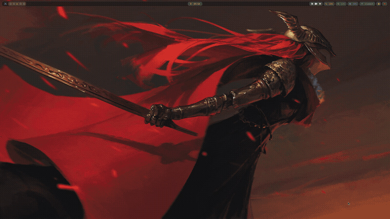

# hypr-rice

A Hyprland rice with **one-click switchable game themes**. Pick a theme and
*everything* follows: wallpaper, window borders, terminal colors, waybar
(colors *and* icons), lock screen, notification center, your folder icon
tint, the mouse cursor set, and even the app icons in the launcher --
each theme draws its own badge frame, and every app in the launcher gets
one of a *pool* of small original emblems for that theme (sword, shield,
coin, flask, gear, sprig, axe, torii gate, radiation trefoil, paw print,
...) picked per-app so the set reads as a real varied icon pack, not one
mark repeated everywhere -- gradient-shaded, supersampled for crisp
edges, with a soft drop shadow. All original artwork: no ripped game
assets, just generic shapes (a sword, a coin, a torii gate, the public
radiation symbol) evocative of each game without copying anyone's
specific art.



*(full-quality video: [demo.mp4](demo.mp4))*

## Themes

| Theme | Vibe | Waybar identity |
|---|---|---|
| **elden-ring** | Erdtree gold on deep umber *(default)* | crossed swords, embers, hourglass |
| **ashen-flame** | dark fiery reds | flames, flask |
| **god-of-war** | Norse gold & frost, Kratos art | axe, sword, shield |
| **fallout** | Pip-Boy green terminal | radioactive, radio tower |
| **cyberpunk-2077** | Night City black & construct yellow | samurai skull, chips, lightning |
| **tokyo-night** | indigo night city | torii gate, crescent moon |
| **gruvbox** | warm retro amber | coffee + classic icons |
| **catppuccin-mocha** | pastel mauve | cat, paw, Pac-Man workspaces |

Each theme has its **own wallpaper collection** — cycling never leaks another
theme's wallpapers (except **ashen-flame**, which shares elden-ring's) — and an extra **auto mode** extracts a palette from
whatever wallpaper is currently showing.

## Keybinds (highlights)

| Keys | Action |
|---|---|
| `Super+T` | Visual theme picker (wallpaper cards, click / arrows / 1-9) |
| `Super+←/→` | Previous / next wallpaper *within the current theme* (videos, when it has any) |
| `Super+Return` | Terminal (alacritty, frosted-glass blur) |
| `Super+Space` | Launcher (walker) |
| `Super+E` | File manager (thunar, theme-tinted folder icons) |
| `Super+L` | Lock screen (hyprlock, themed) |
| `Super+Alt+←/→`, `Super+↑/↓` | Move window focus |
| `Super+Shift+arrows` / `Super+Ctrl+arrows` | Move / resize window |
| `Super+1-9`, `Super+Shift+1-9` | Switch to / move window to workspace |
| `Super+Q` | Close window |
| `Super+F` / `Super+M` / `Super+V` | Fullscreen / maximize / toggle floating |
| `Super+Shift+V` | Clipboard history |
| `Super+Shift+N` | Notification center |
| `Super+Shift+C` | Color picker |
| `Super+Escape` | Power menu (wlogout) |
| `Super+Shift+W` | Video wallpaper on / off |
| `Print` / `Shift+Print` / `Ctrl+Print` | Region / window / full-screen screenshot |

## Install

> **On [Omarchy](https://omarchy.org)?** Use the [Omarchy installer](#omarchy)
> instead — it adds the themes without replacing Omarchy's keybinds, bar or
> Hyprland config.

**Requirements (full install):** Arch Linux, Hyprland ≥ 0.55 (the config is Lua —
`hyprland.lua`), an internet connection, and `sudo`.

**One-liner:**

```bash
curl -fsSL https://raw.githubusercontent.com/404-not-found129/hypr-rice/main/install.sh | bash
```

This clones the repo into `~/.local/share/hypr-rice` (or updates it if it's
already there) and runs the installer from it. Run the same command again
later to pull updates and re-apply.

**Or manually:**

```bash
git clone https://github.com/404-not-found129/hypr-rice.git && cd hypr-rice
chmod +x install.sh
./install.sh
```

The installer:

1. Installs official packages with pacman and AUR packages
   (`aether`, `walker`, `wlogout`, …) with yay/paru — bootstrapping `yay`
   if you have neither.
2. **Backs up** any configs it would overwrite to `~/.config-backup-<date>/`.
3. Copies configs, scripts, and systemd user drop-ins into place.
4. Installs the bundled wallpaper collections, then fetches
   anything missing from wallhaven as a fallback.
5. Sets up folder-icon tinting (papirus-folders + an ACL so no password
   prompts on theme switch).
6. Seeds the default theme (elden-ring).

It is **idempotent** — safe to re-run (e.g. to retry failed wallpaper
downloads).

Afterwards, log into Hyprland and press `Super+T` to apply your first theme.

## Omarchy

`install-omarchy.sh` plugs the rice into [Omarchy](https://omarchy.org)'s own
theme system instead of replacing it. Your keybinds, bar, launcher, terminals
and Hyprland config stay exactly as Omarchy set them up.

```bash
curl -fsSL https://raw.githubusercontent.com/404-not-found129/hypr-rice/main/install-omarchy.sh | bash
```

(or `./install-omarchy.sh` from a clone). It:

1. Adds **elden-ring**, **ashen-flame**, **god-of-war**, **fallout**,
   **cyberpunk-2077** and **catppuccin-mocha** as Omarchy themes in
   `~/.config/omarchy/themes/` — a `colors.toml` (generated from the Aether
   blueprints) plus the theme's wallpaper collection. Omarchy renders
   borders, terminals, the bar, btop, etc. from those colors as usual.
2. Adds the rice's wallpapers to Omarchy's stock **gruvbox** and
   **tokyo-night** (their colors stay Omarchy's).
3. Installs a `theme-set` hook (`~/.config/omarchy/hooks/theme-set.d/hypr-rice.sh`)
   that, on a rice theme, generates the badged app icons, the recolored
   cursor set and tinted Papirus folders. Switching to any other theme
   puts Omarchy's own icons and cursor back.
4. Makes `ls` (eza) colors follow whichever theme is active.
5. Sets up [video wallpapers](#video-wallpapers) — for the rice themes *and*
   any of Omarchy's own.

Pick a theme from Omarchy's theme menu (`Super+Ctrl+Shift+Space`) or with
`omarchy theme set elden-ring`. Cycle wallpapers with Omarchy's background
switcher (`Super+Ctrl+Space`).

To remove it: delete the six theme folders above from `~/.config/omarchy/themes/`,
the `gruvbox`/`tokyo-night` links in `~/.config/omarchy/backgrounds/`, and the
hook, then switch to any Omarchy theme.

## Video wallpapers

Any theme can have a live (video) wallpaper — on both installs, and on
Omarchy for its stock themes too. Drop `.mp4` / `.webm` / `.mkv` / `.mov`
files into:

```
~/Pictures/wallpapers/live/<theme>/      e.g. live/elden-ring/erdtree.mp4
```

Switching to that theme plays its video; a theme with none shows its still
wallpaper as before. The repo doesn't ship videos (game footage isn't ours to
redistribute), so bring your own — any looping clip works.

Videos are played by [mpvpaper](https://github.com/GhostNaN/mpvpaper) (no
audio, hardware decoding, paused automatically while windows cover the whole
screen). It sits above the still wallpaper and below your windows and bar,
and lets clicks through, so Omarchy's desktop double-click menus still work.

| Command | |
|---|---|
| `live-wallpaper next` / `prev` | Next / previous video for the current theme |
| `live-wallpaper off` / `on` / `toggle` | Disable / enable video wallpapers (remembered) |

On the full install `Super+Shift+W` toggles them and `Super+←/→` cycles
videos instead of stills while one is playing. On Omarchy no keys are added
(your keybinds stay Omarchy's) — bind them yourself in
`~/.config/hypr/bindings.lua` if you like, e.g.
`o.bind("SUPER + ALT + W", "Live wallpaper", "~/.local/bin/live-wallpaper toggle")`
(`Super+Shift+W` is taken by Omarchy).

## How it works

- **[Aether](https://github.com/bjarneo/aether)** extracts/applies color
  palettes. Themes are Aether *blueprints* (`config/aether/blueprints/*.json`).
- A **post-apply hook** (`config/aether/custom/hypr-wallpaper/post-apply.sh`)
  runs after every apply: it re-points the wallpaper symlink, drives the
  `awww` wallpaper daemon, reloads Hyprland (borders re-read the palette via
  Lua), swaps waybar's per-theme icons, reloads waybar, tints Papirus folder
  icons to the accent color, and regenerates the app-icon set (see below).
- **`bin/game-icons`** draws a per-theme badge/frame motif (distinct per
  game, not a recolor — see the table above for the vibe) and composites
  every installed app's real, unmodified icon on top, installing the result
  as a real icon theme (`~/.local/share/icons/Aether-Game-<theme>`). Points both
  `gtk-icon-theme-name` in `~/.config/gtk-{3,4}.0/settings.ini` **and**
  `gsettings` at it. Both are needed: this setup has no XSettings daemon
  (no `gnome-settings-daemon`/`xsettingsd`) to bridge `gsettings` into
  running GTK apps, so without the `settings.ini` patch the icon theme only
  ever *looks* applied but nothing on screen changes.
- **`bin/game-cursors`** recolors the open-source Breeze cursor SVGs to a
  two-tone palette derived from the theme accent and builds multi-size
  (24/32/48) Xcursor files, cached per theme and exposed via a stable
  `Aether-Cursor` symlink. Drop a 32x32 `default.png` into
  `~/.local/share/hypr-rice-personal/cursor-overrides/<theme>/` to use a
  personal arrow cursor for a theme (kept out of this repo). All eight
  sets are pre-built at install time (`game-cursors --build <theme>`), so
  switching never waits on generation. Note: apps already running when
  you switch keep their old cursors until restarted (Wayland apps load
  cursor themes at startup).
- **`bin/theme-picker`** (Super+T) is a floating GTK4 grid of theme cards --
  wallpaper preview, palette swatches, active theme highlighted -- styled by
  the current theme's own colors. Click a card, use arrow keys + Enter, or
  press 1-9; Esc closes; Super+T again toggles. It runs as a resident
  service (autostarted by Hyprland) with cached wallpaper thumbnails, so
  the window appears in ~0.3s instead of paying GTK startup + 4K image
  decode on every open. (`bin/themeswitch` remains as a plain walker-dmenu
  fallback.) The active theme's wallpapers are mirrored into `~/Wallpapers`
  so the Aether GUI's local browser only shows on-theme ones.
- **`bin/wallcycle`** (Super+←/→) cycles the active theme's collection through
  `aether --generate`, so colors re-extract per wallpaper. A shared lock keeps
  the two scripts from ever running two applies at once.
- **`bin/waybar-theme-icons`** patches waybar's config with each theme's icon
  set (all glyphs verified against JetBrainsMono Nerd Font).
- **`bin/eza-theme`** writes an `EZA_COLORS` string from the theme accent to
  `~/.config/eza/colors.sh` (sourced by `.bashrc`), so `ls`/`ll`/`la` (aliased
  to [eza](https://github.com/eza-community/eza) with icons + git columns)
  tint their size/date/owner/dir columns to match the active theme.

### Add wallpapers to a theme

Drop images into `~/Pictures/wallpapers/collections/<theme>/` — they're picked
up automatically by both the cycler and the GUI mirror.

### Add a new theme

Create a blueprint JSON in `~/.config/aether/blueprints/` (copy an existing
one), make a matching wallpaper folder in
`~/Pictures/wallpapers/collections/<name>/`, and optionally add an icon set in
`bin/waybar-theme-icons`. It appears in Super+T automatically.

## Troubleshooting

- **Folder icons stop changing color** — a `papirus-icon-theme` package update
  reset the permissions. Re-run:
  `sudo setfacl -R -m u:$USER:rwX /usr/share/icons/Papirus*`
- **App icons in the launcher look default/unbadged** — in this setup, walker's
  GTK4 icon widgets don't reliably honor `gtk-icon-theme-name` for rendering
  (confirmed with a direct `Gtk.IconTheme.lookup_icon()` call, which resolves our
  theme correctly even when walker's own icons don't). `game-icons` works around
  this by also mirroring every generated icon straight into
  `~/.local/share/icons/hicolor/{64x64,128x128}/apps/` -- the universal fallback
  every toolkit checks regardless of the active theme setting -- on every apply.
- **Wallpaper didn't change with the theme** — the wallpaper daemon may not be
  running; check `pgrep awww-daemon`, and note Hyprland autostarts it at login.
- **`hyprctl dispatch` errors about Lua** — with the Lua config plugin,
  dispatch arguments are Lua (`hyprctl dispatch 'hl.dsp.exit()'`), not the
  classic syntax.
- **A wallpaper failed to download** — wallhaven throttles sometimes; re-run
  the installer (the curl one-liner or `./install.sh`), it skips what
  already exists.
- **App icons don't change with the theme** — something (nwg-look,
  lxappearance, a distro default) may have put a hardcoded
  `gtk-icon-theme-name=` line back in `~/.config/gtk-3.0/settings.ini` or
  `gtk-4.0/settings.ini` after `game-icons` set it. Re-running any theme
  switch (`Super+T`) rewrites that line back to the active theme's icon set.

## Credits

- [Aether](https://github.com/bjarneo/aether) by Bjarne Overli — theming engine
- [papirus-folders](https://github.com/PapirusDevelopmentTeam/papirus-folders)
- Wallpapers from [wallhaven.cc](https://wallhaven.cc); game artwork belongs
  to its respective owners

## License

MIT — see [LICENSE](LICENSE).
